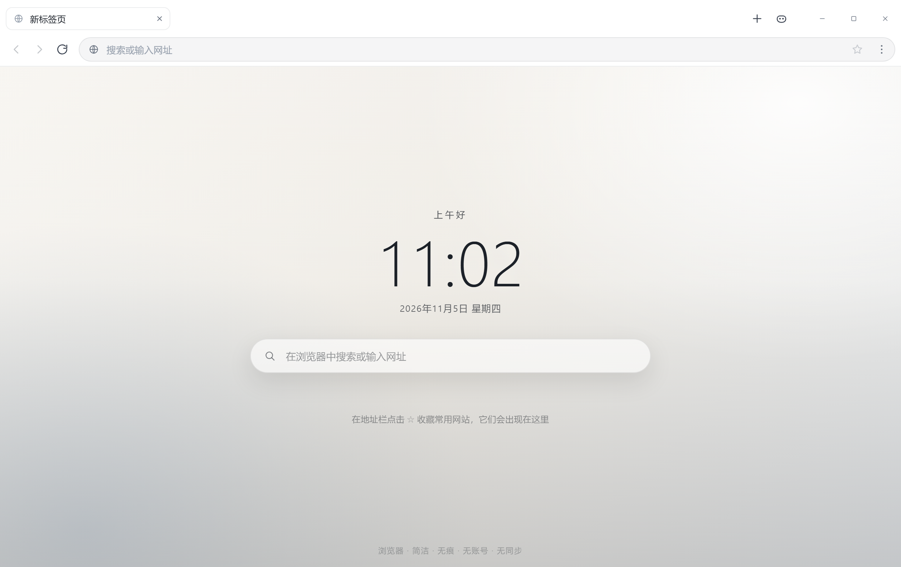
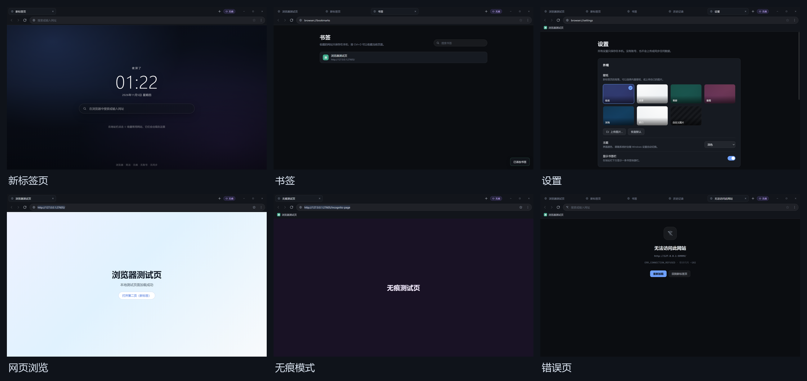
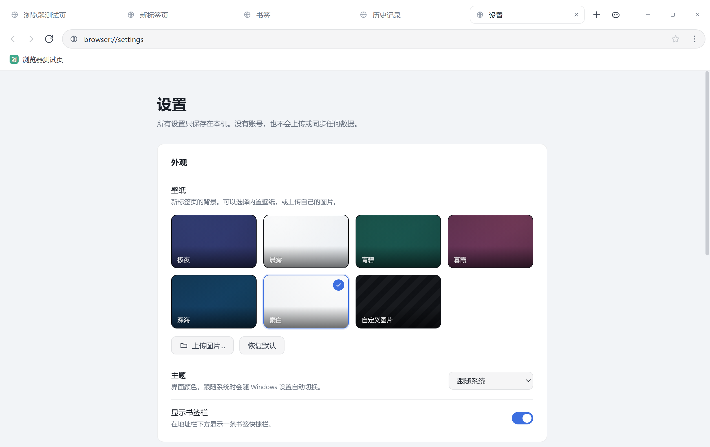
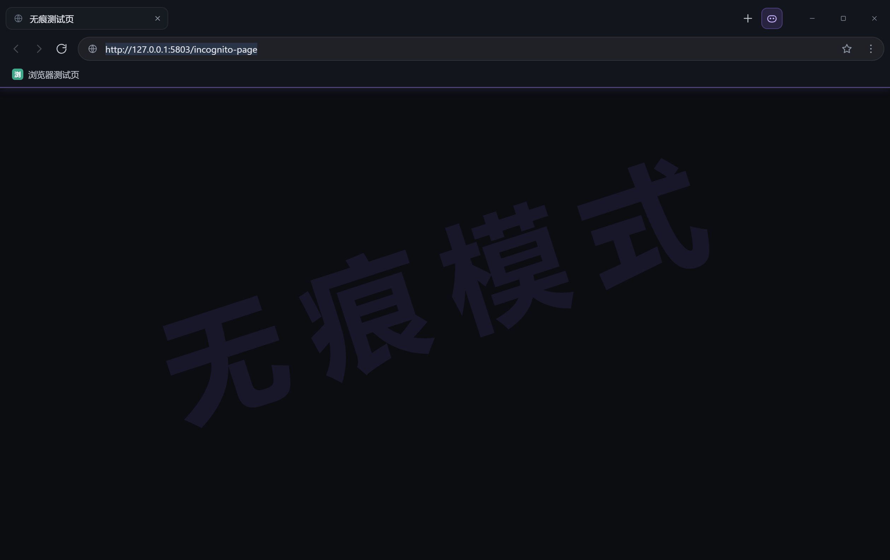
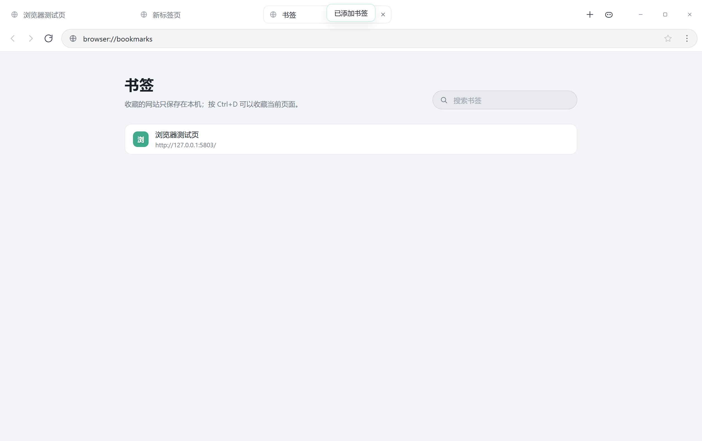
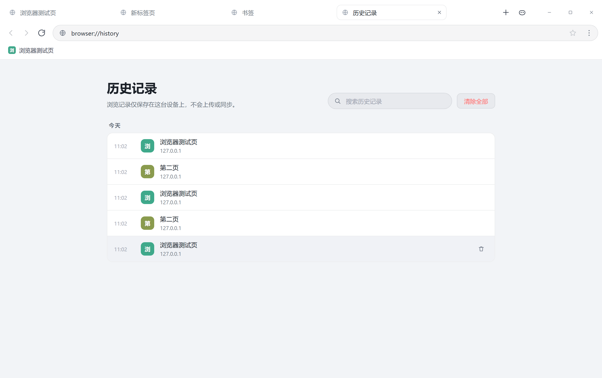

# 浏览器 · liulanqi-browser

**一个基于 Chromium 的简洁桌面浏览器：没有账号、没有云同步、没有登录弹窗、没有遥测，所有数据只保存在本机。**

[](LICENSE)
[](CHANGELOG.md)
[](#系统要求)
[](CONTRIBUTING.md)

<p align="center">
  
</p>

> **English**: A minimal, privacy-first Chromium-based desktop browser for Windows, built as a custom browser shell on Electron.
> No account, no sync, no telemetry — local JSON files only. Uses castlabs ECS runtime for Widevine DRM
> (the CDM itself is never redistributed). Source-only repository; the Electron/Chromium runtime is not included.

## 目录

- [为什么又一个浏览器](#为什么又一个浏览器)
- [功能](#功能)
- [截图](#截图)
- [系统要求](#系统要求)
- [快速开始](#快速开始)
- [快捷键](#快捷键)
- [性能](#性能)
- [视频与 DRM](#视频与-drm)
- [项目结构](#项目结构)
- [测试](#测试)
- [隐私与安全](#隐私与安全)
- [第三方组件与许可](#第三方组件与许可)
- [已知限制](#已知限制)
- [贡献](#贡献)

## 为什么又一个浏览器

日常只需要「打开网页 + 几个标签 + 书签 + 历史」。主流浏览器给的是账号体系、同步、推荐、
遥测和一堆关不掉的入口。这个项目把浏览器缩回它本来的样子：

- **不做账号**：没有登录、没有同步、没有云端；
- **不做遥测**：不统计、不上报、不 phone home；
- **不做推荐的推荐**：新标签页只有搜索框和你自己的书签磁贴；
- **数据属于你**：书签、历史、设置、壁纸都是本地 JSON，随时可以备份、迁移、删掉。

同时不牺牲可用性：H.264/AAC/AV1 视频、Widevine DRM（B 站、Netflix 等加密内容）、
硬件加速、平滑滚动，该有的都有。

## 功能

| 功能 | 说明 |
| --- | --- |
| 标签页 | 新建、关闭、切换、重新打开已关闭的标签页；显示标题与站点图标 |
| 地址栏 | 网址直达；文字自动走搜索引擎；支持 `localhost` / IP / `host:port`；书签星标 |
| 搜索 | 内置 Bing、百度、Google、DuckDuckGo，设置中可切换 |
| 浏览记录 | 按天分组，可搜索、单条删除、一键清空；上限 3000 条 |
| 书签 | 地址栏星标收藏、书签管理页、可开关的书签栏、新标签页快捷磁贴 |
| 无痕浏览 | 独立内存会话窗口，不写历史、不落 Cookie；紫色主题标识 + 界面水印，关闭即清理 |
| 壁纸 | 6 套内置渐变壁纸 + 上传本地图片（自动压缩、持久化） |
| 视频播放 | H.264 (AVC) / AAC / AV1；支持 MP4、DASH、HLS 与 WebCodecs |
| Widevine DRM | 支持 EME 加密视频；启动时从本机 Edge/Chrome 引导 CDM（不随应用分发） |
| 下载 | Chromium 下载器，下载页展示进度并可打开所在文件夹 |
| 内页 | 新标签页、历史、书签、下载、设置、关于、错误页，全部本地渲染、不联网 |
| 主题 | 默认跟随系统（可切深色/浅色）；顶部保留拖动条 |
| 隐私 | 网站权限默认拒绝（仅放行全屏 / 指针锁定 / 剪贴板写入）；无账号、无同步、无遥测 |

## 截图

| 新标签页 | 总览 |
| --- | --- |
|  |  |

| 设置 | 无痕窗口 |
| --- | --- |
|  |  |

| 书签 | 历史记录 |
| --- | --- |
|  |  |

更多 E2E 截图见 [screenshots/](screenshots/)，验收报告见 [docs/e2e-report.json](docs/e2e-report.json)。

## 系统要求

| 项目 | 要求 |
| --- | --- |
| 操作系统 | Windows 10 / 11（x64）。当前仅支持 Windows |
| 运行时 | Electron 43.x；需要 DRM 与 H.264/AAC 时用 castlabs ECS 43.8.6+wvcus |
| Node.js | ≥ 22（只跑测试与脚本时需要，运行浏览器不需要） |
| NSIS | 3.11+（只有打安装包时需要） |

> **本仓库只包含应用源码**，不含 Electron/Chromium 运行时（约 361 MB，且分平台分发）。
> 准备运行时的完整步骤见 [docs/BUILD.md](docs/BUILD.md)。

## 快速开始

### 方式一：下载发布包（推荐，无需环境）

到 [Releases](https://github.com/shenghan1554/liulanqi-browser/releases) 下载：

- `浏览器-安装程序-x.y.z.exe` — 安装版，按向导安装，数据存 `%APPDATA%\浏览器`
- `浏览器-便携版-x.y.z.zip` — 解压即用，数据存同目录 `data\`，拷走整个文件夹即带走全部数据

### 方式二：从源码运行

```powershell
git clone https://github.com/shenghan1554/liulanqi-browser.git
cd liulanqi-browser

# 1) 准备运行时（二选一，详见 docs/BUILD.md）
#    a. 只跑功能：npm install --save-dev electron@43
#    b. 需要 Widevine：把 castlabs ECS 运行时解压为 electron43-wv\

# 2) 跑起来
.\scripts\dev-run.ps1          # 用 electron43-wv 运行时
# 或
npx electron .                 # 用 npm 安装的官方 Electron
```

### 方式三：自己打包

```powershell
# 便携版 → dist\浏览器\
.\scripts\build-portable.ps1

# 安装包 → dist\浏览器-安装程序-1.0.5.exe
.\scripts\build-installer.ps1
```

详细参数与常见问题见 [docs/BUILD.md](docs/BUILD.md)。

## 快捷键

| 快捷键 | 功能 |
| --- | --- |
| `Ctrl+T` / `Ctrl+W` | 新建 / 关闭标签页 |
| `Ctrl+L` | 聚焦地址栏 |
| `Ctrl+R` / `F5` | 刷新 |
| `Ctrl+D` | 收藏当前页 |
| `Ctrl+H` | 浏览记录 |
| `Ctrl+J` | 下载内容 |
| `Ctrl+Shift+B` | 显示 / 隐藏书签栏 |
| `Ctrl+Shift+T` | 重新打开关闭的标签页 |
| `Ctrl+Shift+N` | 新建无痕窗口 |
| `Ctrl+Shift+Delete` | 清除浏览数据 |
| `Ctrl+Tab` / `Ctrl+Shift+Tab` | 下一个 / 上一个标签页 |
| `Alt+←` / `Alt+→` | 后退 / 前进 |
| `Ctrl++` / `Ctrl+-` / `Ctrl+0` | 放大 / 缩小 / 恢复缩放 |
| `Esc` | 停止加载 |

## 性能

针对「用起来卡、滚动不流畅」做了专项处理：

- **强制开启硬件加速**：显式启用 GPU 合成、GPU 光栅化、零拷贝与硬件视频解码，并忽略显卡黑名单
  ——部分旧驱动会被 Chromium 误判为不安全而退回软件渲染，这是整机卡顿最常见的原因；
- **平滑滚动**：开启 Chromium 平滑滚动，滚轮/触控板带惯性动画，手感与 Chrome / Edge 一致；
- **实测对照**：同一台机器、同一个页面（B 站首页）、同一段脚本——本项目滚动约 58 fps，
  Chrome / Edge 约 58 fps；纯空白页稳定 60 fps；
- **1080p 视频**：本地 1920×1080 H.264 连续播放 6 秒为 60 fps，仅丢 1 帧；
- **减少主进程卡顿**：历史标题合并写盘、窗口拖动/缩放合并布局调用、网页标签关闭拼写检查；
- **界面渲染**：标签栏在数量/顺序不变时就地更新标题与图标，避免整栏重建。

设置 → 关于 里有「硬件加速」一栏：显示「视频解码已开启」表示 GPU 正常；显示「软件渲染」
通常是驱动过旧或被远程桌面/虚拟机限制。

## 视频与 DRM

### H.264 / AAC

Chromium 自带 ffmpeg 解码器与 WebCodecs，可直接播放 H.264 (AVC) 视频与 AAC 音频：

- `MediaSource` 支持 `avc1` 与 `mp4a.40.2`，MP4 / DASH / HLS 网页播放器可用；
- 本地实测：52.2 秒、854×480 的 H.264+AAC 样片，画面正常、音视频解码字节数均大于 0
  （见 `screenshots/playback-h264-aac.png`）；
- 验收同时检查 `canPlayType`、`MediaSource.isTypeSupported`、`VideoDecoder` / `AudioDecoder`。

<p align="center">
  
</p>

### Widevine DRM

本项目**不随包分发任何 CDM 二进制**。启动时按以下顺序准备：

1. 检查数据目录 `data/WidevineCdm/<version>/` 是否已有 CDM 组件；
2. 没有则从本机已安装的 Microsoft Edge / Google Chrome 组件目录复制同一份 Widevine CDM；
3. 若系统既无 Edge/Chrome，也无法访问 Google 组件更新服务器，则 DRM 不可用，
   浏览器其它功能不受影响。

> **VMP 说明**：交付构建带 castlabs 的**开发用** VMP 签名。Netflix、Amazon 等要求生产
> VMP 签名的服务不保证可播放；需要生产签名时通过 castlabs EVS 服务重新签名。
> Widevine 授权由各视频服务决定，本项目不提供、也不接受任何绕过 DRM 的实现。

## 项目结构

```
liulanqi-browser/
├─ src/
│  ├─ main/
│  │  ├─ main.js            应用入口、窗口生命周期、会话配置、Widevine 组件准备
│  │  ├─ window-manager.js  窗口 / 标签页 / WebContentsView / 内页 / 书签 / 历史 / 下载 / 快捷键 / IPC
│  │  ├─ media.js           Widevine CDM 检测、从系统 Edge/Chrome 引导组件、媒体能力状态
│  │  ├─ store.js           本地 JSON 数据层（原子写入、损坏文件隔离、历史上限）
│  │  ├─ perf.js            性能相关：性能开关、指标采集
│  │  ├─ ipc.js             渲染层 IPC 通道
│  │  └─ e2e.js             端到端验收脚本（仅 --e2e 时启用）
│  ├─ preload/
│  │  └─ chrome-preload.js  contextBridge 暴露 window.browser API
│  └─ renderer/
│     ├─ index.html         浏览器外壳（标题栏 / 标签栏 / 工具栏 / 书签栏 / 内页容器）
│     ├─ styles.css         深色 / 浅色主题与全部内页样式
│     └─ app.js             UI 渲染、路由、事件处理
├─ test/                    数据层单元测试（纯 Node，不依赖 Electron）
├─ scripts/                 开发启动、截图、打包、安装验证脚本
├─ installer/               NSIS 安装脚本与图标
├─ screenshots/             E2E 截图
└─ docs/                    构建说明与验收报告
```

## 测试

```powershell
# 数据层单元测试（18 项，纯 Node，不需要 Electron 运行时）
npm test

# 端到端验收（真实点击 UI，输出报告与截图）
.\electron43-wv\electron.exe . --e2e --no-sandbox --disable-gpu --disable-breakpad
# 报告：logs/e2e-report.json    截图：screenshots/e2e-*.png
```

当前状态：

- 单元测试 **18/18** 通过
- 端到端验收 **106/106** 通过（导航、前进后退、历史、书签、书签栏、默认主题跟随系统、
  默认壁纸素白、壁纸、自定义壁纸、主题、无痕、无痕状态配色、无痕水印、顶部拖动条、
  错误页、下载、快捷键、地址栏解析、H.264/AAC 解码、Widevine 密钥系统、渲染层无报错等）

CI（[.github/workflows/test.yml](.github/workflows/test.yml)）只跑单元测试，因为端到端需要 GUI 环境。

## 隐私与安全

- 无账号、无登录、无云同步、无遥测；
- 浏览记录 / 书签 / 设置 / 壁纸只写入本地文件；
- 无痕窗口使用独立内存会话，关闭后清空；
- 网站权限请求默认拒绝，仅放行全屏、指针锁定、剪贴板写入；
- Widevine CDM 组件更新由 Chromium 组件更新器负责，仅用于 DRM 能力，不上传浏览数据。

安全模型与漏洞报告方式见 [SECURITY.md](SECURITY.md)。

## 第三方组件与许可

本项目以 **MIT** 协议发布（见 [LICENSE](LICENSE)）。项目**不包含**以下第三方运行时，其许可各自独立：

| 组件 | 许可 | 说明 |
| --- | --- | --- |
| Electron | MIT | 运行时由使用者自行准备 |
| castlabs ECS | MIT | 提供 Widevine 支持；本项目不重新分发签名包 |
| Chromium | BSD 3-Clause | 渲染、网络、音视频、下载、DevTools 均来自 Chromium |
| Widevine CDM | Google 专有 | 不随本项目分发，从系统 Edge/Chrome 读取 |

## 已知限制

- **仅 Windows**：主进程大量使用 Windows 特有行为（窗口、任务栏、NSIS、路径习惯），未适配 macOS / Linux；
- **不是 Chromium 独立发行版**：用 Electron 嵌入 Chromium 并自研浏览器外壳，因此无法像 Chrome 一样
  跟进上游安全补丁节奏——需要等 Electron/ECS 发布新版本；
- **不支持扩展**：没有 Chrome Web Store 兼容层；
- **安装版快捷方式带 `--no-sandbox`**：为兼容部分受限桌面环境，会削弱渲染进程隔离；
  介意的话从源码以默认沙箱运行，或自行去掉该参数；
- **无痕不做安全擦除**：内存会话关闭即清理，但操作系统层面不保证能擦除痕迹；
- **DRM 受服务方限制**：生产 VMP 签名需自行通过 castlabs EVS 获取。

## 贡献

欢迎 Issue 与 PR。动手前请先读：

- [CONTRIBUTING.md](CONTRIBUTING.md) — 开发环境、目录约定、提交规范
- [docs/BUILD.md](docs/BUILD.md) — 运行时准备、打包与常见问题
- [CODE_OF_CONDUCT.md](CODE_OF_CONDUCT.md) — 行为准则
- [CHANGELOG.md](CHANGELOG.md) — 版本记录

特别欢迎：不同 Windows 版本 / 显卡 / DPI 缩放下的兼容性反馈、性能数据、以及文档改进。

## 致谢

- [Electron](https://www.electronjs.org/) 与 [Chromium](https://www.chromium.org/) 提供了整个内核；
- [castlabs Electron for Content Security](https://github.com/castlabs/electron-releases) 提供了 Widevine 支持；
- 图标与壁纸为本项目自制。

---

**本项目与 Google、castlabs、Microsoft、GitHub 均无隶属关系。** Chromium、Widevine、Electron
等名称是其各自所有者的商标。使用本软件即表示你理解并接受：浏览器内核行为由上游决定，
本项目仅提供外壳与本地数据管理。